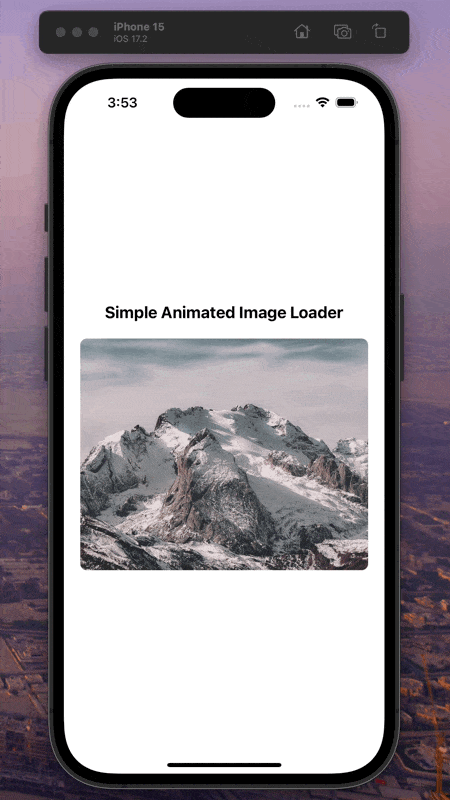
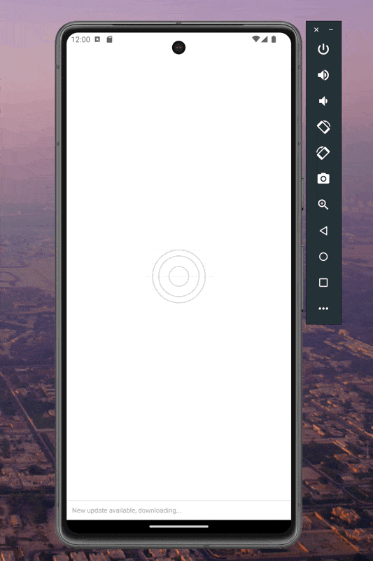
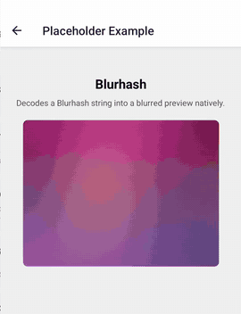
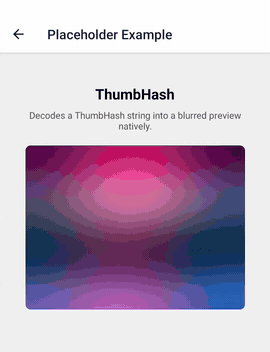
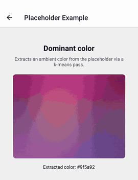
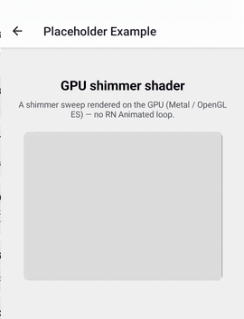
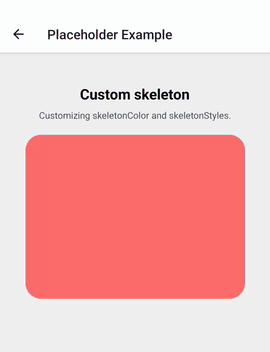

<h1></h1>

[](https://www.npmjs.com/package/react-native-animated-image-loader)
[](https://www.npmjs.com/package/react-native-animated-image-loader)

[](https://opensource.org/licenses/MIT)
[](https://prettier.io)
[](https://eslint.org/)
[](https://github.com/acronimax/react-native-animated-image-loader/actions/workflows/codeql.yml)

<table>
  <tr>
    <td align="center">
      
    </td>
    <td align="center">
      
    </td>
   </tr>
</table>

An image component that shows a placeholder while the real image loads, then crossfades to it. Decoding, placeholder rendering and the crossfade all run natively (a Fabric component backed by C++), off the JS thread.

## Quick start

```sh
npx expo install react-native-animated-image-loader
# or: npm install react-native-animated-image-loader
# or: yarn add react-native-animated-image-loader
```

```tsx
import AnimatedImgLoader from 'react-native-animated-image-loader';

export default function Example() {
  return <AnimatedImgLoader imageUri="https://example.com/photo.jpg" />;
}
```

That's it: a skeleton background shows while the image loads, then crossfades to the image. To use a richer placeholder, pick one from the menu below.

## Contents

- [Requirements](#requirements)
- [Placeholder modes](#placeholder-modes)
  - [Default skeleton](#default-skeleton)
  - [Blurhash](#blurhash)
  - [ThumbHash](#thumbhash)
  - [Dominant color](#dominant-color)
  - [Shimmer shader](#shimmer-shader)
- [Props reference](#props-reference)
- [Advanced customization](#advanced-customization)
  - [Custom sizing and shape](#custom-sizing-and-shape)
  - [Custom skeleton](#custom-skeleton)
  - [Tuning the crossfade](#tuning-the-crossfade)
  - [Reacting to the extracted color](#reacting-to-the-extracted-color)
- [Using with Expo](#using-with-expo)
- [Web](#web)
- [Contributing](#contributing)
- [License](#license)

## Requirements

- `react-native >= 0.81.0` and `react >= 19.0.0`
- The **New Architecture** must be enabled. Only the Fabric component and TurboModule paths are implemented, with no legacy-bridge fallback.
- iOS and Android (see [Web](#web) for the web fallback)

## Placeholder modes

Choose a mode with the `placeholderType` prop. Modes that decode a hash also need `placeholderHash`. Left unset, `placeholderType` shows the [default skeleton](#default-skeleton).

| Mode                                  | `placeholderType`  | Needs `placeholderHash` | Best for                                       |
|---------------------------------------|--------------------|:-----------------------:|------------------------------------------------|
| [Default skeleton](#default-skeleton) | *(unset)*          |           No            | Zero setup                                     |
| [Blurhash](#blurhash)                 | `'blurhash'`       |           Yes           | A compact blurred preview                      |
| [ThumbHash](#thumbhash)               | `'thumbhash'`      |           Yes           | A blurred preview that keeps aspect and alpha  |
| [Dominant color](#dominant-color)     | `'dominant-color'` |           Yes           | A flat ambient color, plus the color as an event |
| [Shimmer shader](#shimmer-shader)     | `'shimmer-shader'` |           No            | A GPU-driven loading sweep                     |

### Default skeleton

No hash and no `placeholderType`: the `skeletonColor` and `skeletonStyles` props show through while the image loads.

```tsx
<AnimatedImgLoader imageUri={uri} />
```

### Blurhash

Pass a [Blurhash](https://blurha.sh) string. It is decoded natively, off the JS thread.

```tsx
<AnimatedImgLoader
  imageUri={uri}
  placeholderType="blurhash"
  placeholderHash="LDHbvZ}b1FI[_}I.60Wnvqr_xT$%"
/>
```

<p align="center">
  <br />
  <sub>Android</sub>
</p>

### ThumbHash

Pass a [ThumbHash](https://evanw.github.io/thumbhash/) string (base64).

```tsx
<AnimatedImgLoader
  imageUri={uri}
  placeholderType="thumbhash"
  placeholderHash="2HYKHAwpN2aIiHBaqHcqb6Xx1g=="
/>
```

<p align="center">
  <br />
  <sub>Android</sub>
</p>

### Dominant color

Extracts an ambient color from the hash using a k-means pass and renders it as a flat placeholder. The color is also reported through [`onPaletteExtracted`](#reacting-to-the-extracted-color).

Because `'dominant-color'` isn't itself a hash format, set `placeholderHashType` to say which format `placeholderHash` is in. It defaults to `'blurhash'`.

```tsx
<AnimatedImgLoader
  imageUri={uri}
  placeholderType="dominant-color"
  placeholderHash={blurhash}
  placeholderHashType="blurhash" // or 'thumbhash'
/>
```

<p align="center">
  <br />
  <sub>Android</sub>
</p>

### Shimmer shader

A shimmer sweep rendered on the GPU (Metal on iOS, OpenGL ES on Android), with no React Native `Animated` loop. It needs no hash.

```tsx
<AnimatedImgLoader imageUri={uri} placeholderType="shimmer-shader" />
```

<p align="center">
  <br />
  <sub>Android</sub>
</p>

> Generate hashes ahead of time (on your server or at upload) with the [`blurhash`](https://www.npmjs.com/package/blurhash) and [`thumbhash`](https://www.npmjs.com/package/thumbhash) packages, and ship them alongside each image URL.

## Props reference

| Prop                      | Type                                                       | Default                                                                  | Description                                                                                                                                                         |
|---------------------------|------------------------------------------------------------|--------------------------------------------------------------------------|---------------------------------------------------------------------------------------------------------------------------------------------------------------------|
| **`imageUri`**            | `string`                                                   | **required**                                                             | URL of the image to load.                                                                                                                                           |
| `placeholderType`         | `'blurhash'` \| `'thumbhash'` \| `'dominant-color'` \| `'shimmer-shader'` | `undefined`                                               | Placeholder to render while loading. Left unset, `skeletonColor` / `skeletonStyles` show through. Native only.                                                      |
| `placeholderHash`         | `string`                                                   | `undefined`                                                              | Blurhash or ThumbHash string, decoded natively. Used by `blurhash`, `thumbhash` and `dominant-color`.                                                               |
| `placeholderHashType`     | `'blurhash'` \| `'thumbhash'`                              | `'blurhash'`                                                             | The real hash format. Only needed when `placeholderType` is `'dominant-color'`.                                                                                     |
| `fadeDuration`            | `number`                                                   | `300`                                                                    | Native crossfade duration in milliseconds. Native only.                                                                                                             |
| `onPaletteExtracted`      | `(event: { nativeEvent: { color: string } }) => void`      | `undefined`                                                              | Fires once the native side extracts a dominant or ambient color. Native only.                                                                                       |
| `loaderContainerStyles`   | `ViewStyle`                                                | `{ borderRadius: 8, width: '90%', height: 250, overflow: 'hidden' }`     | Styles for the container that wraps the loader.                                                                                                                     |
| `skeletonStyles`          | `ViewStyle`                                                | `{ alignItems: 'center', justifyContent: 'center' }`                     | Styles for the skeleton layer behind the image.                                                                                                                     |
| `skeletonColor`           | `string`                                                   | `'rgba(0,0,0,.2)'`                                                       | Skeleton background color.                                                                                                                                          |

The `AnimatedImgLoaderProps` and `PlaceholderType` types are exported from the package.

## Advanced customization

### Custom sizing and shape

`loaderContainerStyles` replaces the default container style, so include every property you want to keep.

```tsx
<AnimatedImgLoader
  imageUri={uri}
  loaderContainerStyles={{
    width: 120,
    height: 120,
    borderRadius: 60,
    overflow: 'hidden',
  }}
/>
```

### Custom skeleton

```tsx
<AnimatedImgLoader
  imageUri={uri}
  skeletonColor="#FF6B6B"
  skeletonStyles={{ borderRadius: 24 }}
/>
```

<p align="center">
  <br />
  <sub>Android</sub>
</p>

### Tuning the crossfade

```tsx
<AnimatedImgLoader
  imageUri={uri}
  placeholderType="blurhash"
  placeholderHash={blurhash}
  fadeDuration={600}
/>
```

### Reacting to the extracted color

Use the color the native side extracts to theme the surrounding UI, such as a card background.

```tsx
const [color, setColor] = React.useState<string | null>(null);

<View style={{ backgroundColor: color ?? 'transparent' }}>
  <AnimatedImgLoader
    imageUri={uri}
    placeholderType="dominant-color"
    placeholderHash={blurhash}
    onPaletteExtracted={(event) => setColor(event.nativeEvent.color)}
  />
</View>;
```

## Using with Expo

Install with `npx expo install`, which picks a version compatible with your Expo SDK:

```sh
npx expo install react-native-animated-image-loader
```

This library ships custom native code (a Fabric component and a TurboModule), so it **will not run inside Expo Go**. Expo Go only bundles Expo's own pre-registered native modules and can't load arbitrary third-party native code. You'll need a [development build](https://docs.expo.dev/develop/development-builds/introduction/) instead:

```sh
npx expo prebuild
npx expo run:ios     # or: npx expo run:android
```

Or build a dev client with [EAS Build](https://docs.expo.dev/develop/development-builds/create-a-build/) if you're not building locally. See Expo's [Adding custom native code](https://docs.expo.dev/workflow/customizing/) guide for more on why a plain Expo Go install can't satisfy this and what a development build gives you instead.

### Expo SDK and New Architecture requirements

- **Minimum Expo SDK: 54** (matching the `react-native >=0.81.0` peer dependency; Expo SDK 54 is the first SDK built on React Native 0.81).
- **The New Architecture must be enabled.** There's no legacy-bridge fallback, so it will not work with `newArchEnabled: false`. This has been Expo's default since SDK 52, so most projects need no changes.

## Web

`react-native-web` has no Fabric or TurboModule support, so the web build uses a pure-JS `Animated` fallback. `imageUri`, `loaderContainerStyles`, `skeletonStyles` and `skeletonColor` work as on native. `placeholderType`, `placeholderHash`, `placeholderHashType`, `fadeDuration` and `onPaletteExtracted` are accepted for type compatibility but have no effect.

## Contributing

See the [contributing guide](CONTRIBUTING.md) to learn how to contribute to the repository and the development workflow.

### Running the example app

`example/` is a managed Expo app that gets its native `ios/` and `android/` projects via `expo prebuild`, with the New Architecture enabled. It has a screen for each placeholder mode above.

**Prerequisites**
- Xcode + CocoaPods, for iOS
- Android Studio (SDK + NDK) and a JDK Gradle supports (JDK 17 is known-good; Gradle does not yet support the very latest JDKs bundled with newer Android Studio releases)

**iOS**
```sh
cd example
yarn install
npx expo prebuild --platform ios
cd ios && pod install && cd ..
yarn ios
```

**Android**
```sh
cd example
yarn install
npx expo prebuild --platform android
cd android && ./gradlew :app:assembleDebug && cd ..
yarn android
```

## License

MIT

---

Made with [create-react-native-library](https://github.com/callstack/react-native-builder-bob)
